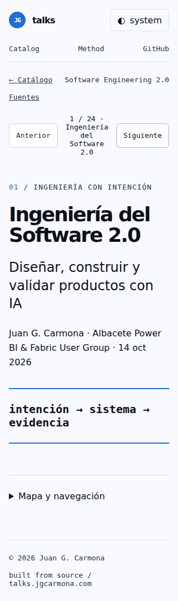
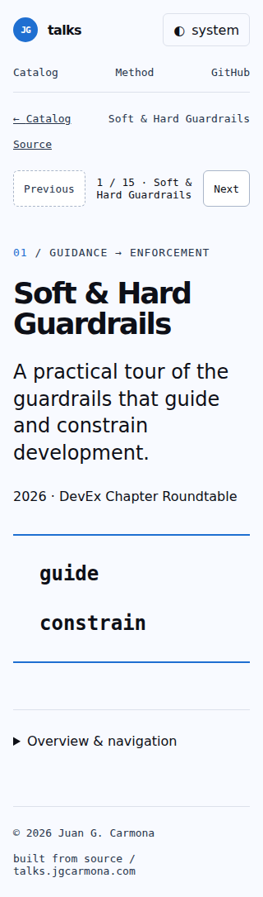

# Issue 18: standalone talks

Accepted first implementation, merged in [PR #38](https://github.com/juangcarmona/presentations/pull/38). Visual polish continues in [issue #39](https://github.com/juangcarmona/presentations/issues/39).

- [Integration report](runs/40236710116/attempt-0001/post-integration/report.md)
- [Final retrospective](runs/40236710116/attempt-0001/post-integration/retrospective.md)
- [Original agent retrospective](runs/40236710116/attempt-0001/post-integration/agent-retrospective.md)
- [All screenshots](runs/40236710116/attempt-0001/post-integration/screenshots/)
- [Evidence index](runs/40236710116/attempt-0001/post-integration/evidence-index.json)

## Mobile previews

